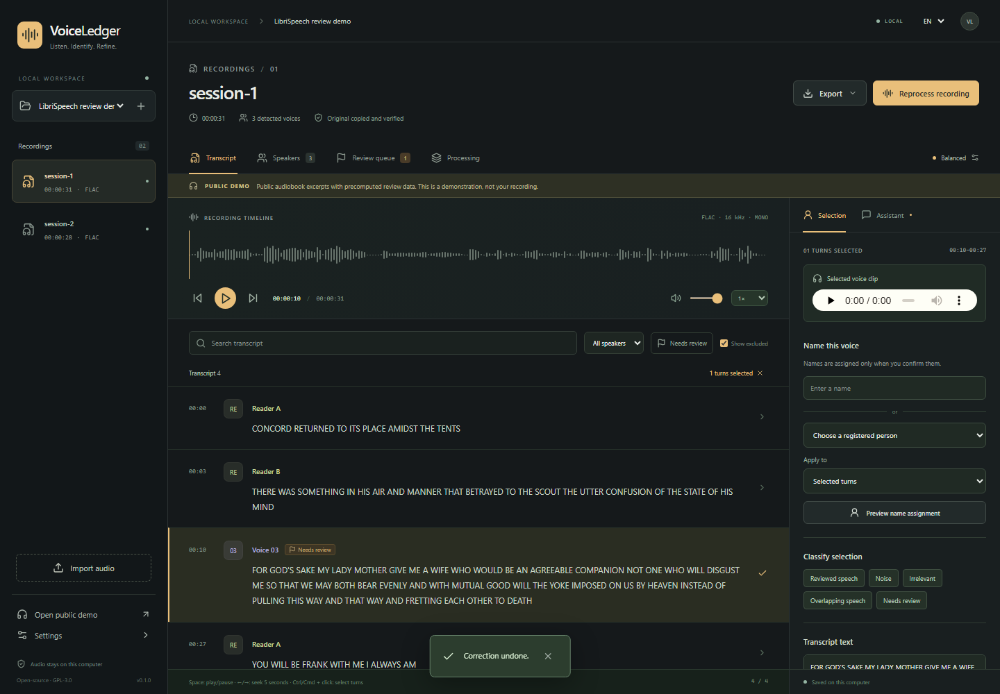

# VoiceLedger

Локално транскрибиране, преглед на говорители и история на потвърдените корекции.

[English](README.md) · [Архитектура](docs/architecture.md) · [Измерени резултати](docs/benchmarks.md)



VoiceLedger е приложение за Windows, което се отваря в браузъра. То обработва аудиозаписи с процесора на компютъра, различава анонимни гласове и помага да свържете един човек с няколко записа. Вие прослушвате откъсите и потвърждавате имената. Сходството между гласове не се представя като вероятност и не води до автоматично свързване.

**Версия 0.1.0 е предварителна.** Локалната обработка и прегледът са проверени под Windows. Точността за българска реч все още изисква ръчно проверен еталон. Английският демонстрационен проект използва означенията от публичния набор данни, а не резултати, предсказани от модел.

## Инсталиране

Необходими са Windows x64, [Node.js 24](https://nodejs.org/) и актуален браузър, базиран на Chromium. Скриптът инсталира Python 3.12 и библиотеките за работа с процесор. Приложението е изпитано на компютър с 16 GB RAM. Затворете тежките програми преди обработване на дълги записи. Предвидете ориентировъчно 20 GB свободно място за всички режими, средите и работните файлове; голяма библиотека ще изисква повече.

1. Клонирайте хранилището или разархивирайте изходния код в папка с право за запис.
2. Стартирайте **Setup.cmd**. Първоначалната инсталация изисква интернет и изтегля големи зависимости. Версиите са заключени в предоставените файлове.
3. Стартирайте **Launch.cmd**. Приложението се отваря на **http://127.0.0.1:8020**. Оставете прозореца за стартиране отворен.
4. Изберете **Open public demo**, за да разгледате публичния пример без модели и регистрация. Сменете езика на интерфейса от горния десен ъгъл.
5. За собствени записи приемете [условията за Community-1](https://huggingface.co/pyannote/speaker-diarization-community-1) в профила си в Hugging Face. От **Настройки** отворете локалната страница за вход за моделите. Въведете там токен с право за четене. Не публикувайте токена в чат, код или GitHub.
6. Изтеглете избрания режим от **Настройки**. Всеки режим включва и общия модел за говорители. При прекъсване опитайте изтеглянето отново. Не се изискват права за символни връзки или режим за разработчици на Windows.

Няма платена услуга за транскрипция и не е необходим платен API ключ. Помощникът за писмени корекции използва наличния ви достъп до Codex чрез ChatGPT и неговите ограничения. Ръчните контроли работят без Codex.

Диагностика от папката на проекта:

```powershell
.venv\Scripts\python.exe -m voiceledger.cli doctor
```

## Обработка и преглед

Създайте проект чрез **+** и добавете аудио. Приложението копира оригинала и проверява неговата контролна сума. Подаденият файл не се променя. По подразбиране езикът за транскрипция е български, независимо от езика на менютата.

| Режим | Модел | Начална настройка |
|---|---|---|
| Бърза чернова | `small` | beam 1 |
| Балансиран | `large-v3-turbo` | beam 3 |
| Точност | `large-v3` | beam 5 |

Всички режими използват CPU INT8, времена за думите и разпознаване на говорители. Стартирайте обработката и следете раздела **Обработка**. Може да отменяте и възобновявате задачите. Само един тежък модел работи в даден момент.

Изберете реплика за прослушване и редактиране. Ctrl/Cmd + щракване избира няколко реплики. Интервал пуска или спира звука, а стрелките наляво/надясно преместват с пет секунди, когато не редактирате поле. Налични са търсене, филтри по говорител и опашка за преглед.

Въведете име или изберете регистриран човек. Прегледайте предложението преди прилагане. Може да обхванете само избраните реплики или всички реплики на този разпознат глас в записа. Съхранявайте еталонни откъси само след лично потвърждение, че съдържат чистия, отделен глас на човека. По възможност използвайте няколко примера с обща продължителност около 20–30 секунди.

В **Говорители** сравнете гласа с кандидатите и техните еталонни откъси. Потвърдете съвпадението лично. При пропуснат кратък участник изберете съответния интервал и поискайте повторна проверка с минимален брой говорители.

Поддържат се преименуване и пренасочване, обединяване на самоличности, разделяне на реплики, промяна на граници и текст, както и означаване на шум, нерелевантна реч, застъпване и несигурност. Корекциите се пазят отделно от първоначалните резултати. При повторна обработка променени реплики се показват като конфликти за преглед. Отмяната на завършена повторна проверка възстановява предишния анализ; първо отменете по-новите зависими проверки.

Изключените области остават възстановими. По подразбиране не се включват при експорт. Налични са TXT, SRT, CSV и JSON с версия на схемата. Общите TXT/CSV/JSON запазват границите и локалните времена на записите. Общият SRT подрежда времевите линии една след друга и означава източника на всяка реплика; той е за аудио, сглобено в същия ред.

## Писмени корекции

Ако е необходимо, инсталирайте [Codex CLI](https://developers.openai.com/codex/cli/) и изпълнете `codex login`, като влезете с **ChatGPT**. Входът чрез API ключ не се използва. Приложението търси и инсталирания Codex за Windows. При нужда задайте `VOICELEDGER_CODEX_PATH` към изпълнимия файл преди стартиране.

Изберете реплики и отворете **Помощник**. Напишете например „Това е Ясен“, „Тук има поне трима души“ или „Маркирай този откъс като фонов шум“. Помощникът предлага корекция; вие я проверявате и прилагате. При двусмислие иска уточнение. При изчерпан лимит, неуспешен вход или несъвместима версия използвайте ръчните контроли.

Към Codex се изпращат инструкцията ви, идентификаторите и времената на избраните реплики и регистрираните имена. Аудио, гласови представяния и текстът на транскрипцията не се добавят като контекст. Личен текст, който сами напишете в инструкцията, се изпраща към Codex. Заявките са с временна сесия, ограничени права, изключени инструменти и проверен структуриран отговор. Моделът не може сам да приложи промяната.

## Данни и възстановяване

Частните данни са в **`%LOCALAPPDATA%\VoiceLedger`**, извън хранилището. Там са копията на оригиналите, работното аудио, транскрипциите, профилите, еталоните, моделите, задачите и базата SQLite. Hugging Face и Codex управляват собствените си локални данни за вход. Експортът не съдържа токени, гласови вектори или абсолютни пътища до оригиналите.

Транскрипцията се запазва на части от десет минути с две секунди контекст. При прекъсване завършените части се използват повторно. Прекъснатият анализ на говорителите започва отначало само за този етап. След рестарт прекъснатите задачи могат да бъдат възобновени. Промяна на име не стартира моделите повторно.

За резервно копие затворете приложението и копирайте цялата папка с данни. Преди промяна на съществуващата схема се създава и резервно копие на базата. `VOICELEDGER_DATA_DIR` позволява друга локална папка; не я поставяйте в Git хранилището. `VOICELEDGER_THREADS` променя ограничението от осем CPU нишки.

След изтеглянето на моделите обработката и ръчният преглед работят локално. Телеметрията за обработка е изключена по подразбиране. Интернет е необходим за изтегляне, вход и заявките към Codex. Услугата слуша само на този компютър и не е предназначена за публичен сървър.

## Проверки и ограничения

[Измерванията и процедурата за пилотен преглед](docs/benchmarks.md) разграничават скоростта от точността. Автоматичните проверки обхващат декодиране, непроменени оригинали, времена, застъпване, корекции, отмяна, експорт и помощника. Браузърните проверки обхващат запазване след рестарт на страницата, двата езика, звуковата вълна, 5000 реплики и мобилен изглед. GitHub Actions не използва лични записи, профили или платени заявки.

Целите за българския пилот са до 25% грешни думи и поне 85% вярно приписана незастъпваща се реч след съпоставяне на анонимните етикети с реални хора. Това са непотвърдени цели, а не обещание. Проверете ръчно около три минути. При проблем пробвайте трудните откъси в режим **Точност** и отбележете оставащите грешки.

Кратки участия, шум и едновременна реч могат да объркат моделите. Whisper може да пропусне или измисли думи. Контекстът между частите намалява граничните грешки, но не гарантира съвпадащи времена. Паметта за анализ на говорители нараства с дължината на записа. Измервания върху една минута не са надежден срок за многочасова обработка.

Инсталатор, запис на живо, споделена облачна услуга, автоматично разделяне на едновременни гласове и обучение на модели не са част от тази версия.

Кодът е **GPL-3.0-only**. Моделите, зависимостите и [публичният пример](demo/README.md) са със [собствени лицензи](THIRD_PARTY.md). За разработка и проверки вижте [CONTRIBUTING.md](CONTRIBUTING.md). Първо се компилира интерфейсът, след което се синхронизира Python средата.
