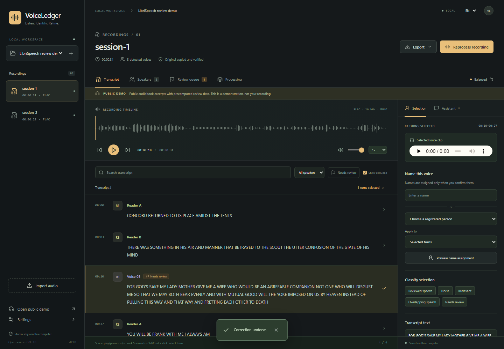

# VoiceLedger

Local transcription, speaker review, and a record of the corrections you confirm.

[Български](README.bg.md) · [Architecture](docs/architecture.md) · [Measured results](docs/benchmarks.md) · [Contributing](CONTRIBUTING.md)



VoiceLedger is a Windows application that runs in your browser. It transcribes recordings on your CPU, separates anonymous speaker turns, and helps you attach consistent names across recordings. You listen, compare clips, and confirm identities. The app never joins people automatically.

The interface uses soft glass surfaces, amber highlights and responsive motion. Tabs, dialogs, playback and buttons give immediate feedback; reduced-motion settings are respected. Processing shows the current project's jobs with direct links to completed transcripts. [Interface notes](docs/interface.md) describe the interaction and accessibility checks.

**v0.1.0 is a preview.** The local engine and review workflow have been exercised on Windows. Bulgarian word accuracy and speaker attribution still need a manually reviewed reference. The included English demo uses dataset annotations, clearly labeled as precomputed review data.

## What works

- English and Bulgarian menus; Bulgarian transcription by default.
- Three CPU INT8 modes: Fast draft (`small`, beam 1), Balanced (`large-v3-turbo`, beam 3), and Accuracy (`large-v3`, beam 5).
- Original audio playback, waveform peaks, synchronized transcript, search, keyboard navigation, speaker filters and a review queue.
- Speaker clips, confirmed voice references, and cross-recording similarity comparisons requiring your confirmation.
- Naming, reassignment, reversible identity merges, text edits, turn splits, boundary changes, and noise/irrelevant/overlap/uncertainty labels.
- An optional English/Bulgarian correction assistant using your installed Codex CLI and ChatGPT sign-in. Every change is previewed before you apply it.
- Persistent jobs, cancellation, resume, revision checks, correction history, and TXT/SRT/CSV/versioned JSON exports for one or several recordings.

## Windows setup

Use Windows x64, [Node.js 24](https://nodejs.org/), and a current Chromium-based browser. Python 3.12 and the CPU libraries are installed by the setup script. A 16 GB RAM computer is the tested starting point; close memory-heavy applications for long recordings. Allow roughly 20 GB free for all model modes, environments and working files, with more space for a large library.

1. Clone this repository or extract its source archive to a writable folder.
2. Open **Setup.cmd**. Initial setup needs internet access and downloads several large dependencies. It installs a project-private environment using pinned dependency locks.
3. Open **Launch.cmd**. Your browser opens at **http://127.0.0.1:8020**. Keep the launcher running while using the app.
4. Choose **Open public demo** to try review and exports immediately, without model downloads or an account.
5. For your own recordings, open **Settings**. Accept the [Community-1 download conditions](https://huggingface.co/pyannote/speaker-diarization-community-1) in your Hugging Face account. Open the app's **local model sign-in page** and enter a Hugging Face read token there. Do not put tokens in chat, source files or GitHub issues.
6. Download the processing mode you want in Settings. Each mode also downloads the shared speaker model. Downloads resume when retried and do not need Windows developer mode or administrator symlink privileges.

No paid transcription service or API key is used. Model downloads are free. The optional assistant uses your existing ChatGPT Codex allowance and its limits. Manual controls work without Codex.

The launcher shows a quiet studio status screen with a small cat that occasionally wanders, blinks or looks around. Press **O** to reopen the browser, **L** to open the private session log, or **Q** to stop the app safely. Keep the window open or minimized while working. Launching again connects to an existing VoiceLedger service; in that case Q closes only the companion. Technical output is kept under `%LOCALAPPDATA%\VoiceLedger\logs`. Startup failures show the log location. `Launch.cmd --plain` uses a static display; `Launch.cmd --preview --seconds 20` previews the cat without starting a service. The ordinary diagnostic launch remains available through `python -m voiceledger.cli launch`.

For installation diagnostics, run this in the project folder:

```powershell
.venv\Scripts\python.exe -m voiceledger.cli doctor
```

## Review a recording

Create a project with the **+** control, then import audio. Import copies and verifies the original; it never edits the supplied file. Choose a mode and transcription language, then start processing. The **Processing** tab shows progress, cancel and resume controls. One heavy model runs at a time.

Choose **Start review**. For each short excerpt, click **Play this excerpt**, enter a name if you recognize the voice, and correct the words. **Save & next** saves both edits and opens the next excerpt. **Skip for now** moves on without approving uncertain words. The excerpt player stops at the selected end time. You can also click any excerpt directly. On a narrow window the editor fills the screen; **Back to transcript** closes it. The folder button opens your recording list.

Enter a person's name or select a registered person. The checkbox lets you name every excerpt of that detected voice in this recording. Name assignment options include a separate proposal preview. **Other corrections** contains boundaries, splitting, exclusions, speaker rechecks and reference creation. These tools remain available without occupying the normal review form. Use several clean clips totaling about 20–30 seconds where possible to build a reference. Only save a reference after listening and confirming that it contains that person's clear, isolated voice.

Search and **Filters** narrow the transcript. Ctrl/Cmd-click selects several excerpts. Space plays or pauses; Left/Right seeks five seconds when you are outside an editing control. Processing mode and reprocessing controls live in **Settings**.

In **Speakers**, compare a detected voice with registered profiles and their reference clips. Similarity is a ranking score, not a probability. Confirm the name yourself. Brief appearances and overlapping voices can confuse automatic clustering; select the affected interval and request a recheck with a minimum speaker count.

Corrections are stored separately from model output. Reprocessing keeps them, and changes to turn IDs appear as conflicts for review. Undo restores a correction; undoing a completed speaker recheck restores its previous analysis. Undo newer dependent rechecks first. Excluded regions stay recoverable and are omitted from exports unless you choose to include them.

Combined TXT/CSV/JSON exports retain each recording's boundary and local timestamps. Combined SRT concatenates the recording timelines and labels cues with their source filename. It is intended for audio assembled in the same order.

## Written corrections with Codex

Install the [Codex CLI](https://developers.openai.com/codex/cli/) if it is not already available, then use `codex login` with **ChatGPT**. API-key authentication is intentionally rejected. The app also looks for the installed Windows Codex app. If needed, set `VOICELEDGER_CODEX_PATH` to the full CLI executable path before launching.

Select turns, open **Assistant**, and write a correction such as “This is Yasen,” “There are at least three speakers here,” or “Маркирай този откъс като фонов шум.” Review its proposed changes and apply them. Missing names or boundaries produce clarification. Sign-in failures, incompatible CLI versions, timeouts and usage limits leave direct controls available.

The assistant sends your instruction, selected IDs/timestamps and registered speaker names. It does **not** receive audio, voice embeddings or the transcript as context. Any private text you put in the instruction itself is sent to Codex. Requests use an ephemeral session, restricted permissions, disabled tools/connectors and validated structured output; the model cannot apply corrections directly. This adapter was smoke-tested with Codex CLI `0.166.0-alpha.6` using fictional English and Bulgarian corrections.

## Local data and recovery

Runtime files live under **`%LOCALAPPDATA%\VoiceLedger`**, outside this repository. This includes imported originals, decoded working audio, transcripts, profiles, references, model weights, job artifacts and the SQLite database. Hugging Face and Codex keep their own local account credentials. VoiceLedger does not export credentials, embeddings or absolute source paths.

Transcription uses ten-minute checkpoints with two seconds of context. Cancelled ASR resumes from completed sections. Interrupted diarization restarts that stage while retaining completed transcription. Restarted jobs appear as interrupted and can be resumed. A settings/model change gets a separate cache. Renaming a speaker does not rerun inference.

To back up, close the app and copy the complete runtime directory. Database migrations also create a private backup before changing an existing schema. An environment override, `VOICELEDGER_DATA_DIR`, supports a separate local data directory; do not point it inside the Git repository. `VOICELEDGER_THREADS` changes the CPU thread cap, which defaults to eight.

Audio processing and manual review use local files after model downloads. Processing telemetry is disabled by default. Downloads, sign-in and optional Codex requests require network access. The service binds to this computer only. It is not a shared or hosted application.

## Validation and limits

See [measured results and the pilot procedure](docs/benchmarks.md). Automated tests cover decoding and hashes, sample clocks, section ownership, overlap and missing speech, revision conflicts, recheck undo, cross-recording merges, exports and assistant validation. Browser tests cover persistence, guided save-and-next, audio playback, bilingual controls, waveform rendering, a 5,000-turn transcript, short windows and a 319 px app pane. GitHub Actions needs no private recordings, credentials, model downloads or paid calls.

Speaker identities need human confirmation. Overlapping voices can be flagged, but this release does not separate voices. Whisper can miss speech or invent words, especially in noise or silence. Boundary context reduces seam errors but does not guarantee identical word timing between chunks. Whole-recording diarization needs memory proportional to recording length. Full multi-hour processing time is not established by one-minute timings.

The Bulgarian pilot targets are at most 25% word error rate and at least 85% correct attribution on annotated, non-overlapping speech after mapping anonymous clusters to known people. These are unverified targets, not promised performance. Review approximately three minutes manually before committing to a full batch. If needed, retry difficult material in Accuracy mode and document remaining errors.

A desktop installer, live recording, hosted multi-user access, automatic voice separation and model training are outside this release.

## Development and license

Build the frontend before synchronizing Python, since the Python package includes the built interface:

```powershell
npm --prefix frontend ci
npm --prefix frontend run build
uv sync --frozen --python 3.12
uv run pytest -q
uv run ruff check src tests scripts
npm --prefix frontend test
```

See [CONTRIBUTING.md](CONTRIBUTING.md) for browser and opt-in real-model checks. Application code is **GPL-3.0-only**. [Third-party notices](THIRD_PARTY.md) document separate dependency/model licenses. The [public LibriSpeech demo](demo/README.md) is CC BY 4.0, with attribution and source-file details in its manifest. Private recordings and model weights are excluded from publication.
