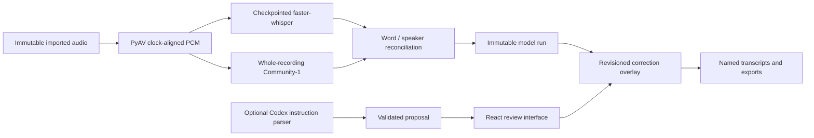

# Architecture

## Runtime

A single FastAPI/Uvicorn process owns the SQLite project store and job queue. One isolated Python subprocess performs one heavy inference stage at a time. Workers write atomic artifacts and progress events; they never write to SQLite. A per-data-directory lock prevents two app instances from starting competing schedulers.

Originals are streamed to UUID-named folders and hash-verified. Audio working files are 16 kHz mono float PCM. Sample placement follows the source presentation timestamps before resampling, including small timestamp overlaps observed in phone AAC files. Conversion records timing adjustments and rejects discontinuities over 100 ms. Original recordings remain available for native-rate listening clips and browser range playback.

ASR uses ten-minute cores and two seconds of boundary context. Diarization analyzes the entire recording with CPU batches of one. Transcript words are aligned to exclusive turns while real overlapping speech is retained separately. Detected speech without reliable text enters the review queue.

Artifacts are keyed by source hash, processing settings, pipeline version and model revisions. Full-recording diarization is shared across ASR modes. Rechecking a region reuses existing ASR words where available and creates new recording-local speaker clusters. Model changes cannot silently relabel those clusters as a real person.

## Corrections and identities

Raw inference runs are retained. Assignments, text edits, splits, region categories and identity merges are stored as reversible commands. Proposals include a base revision; stale proposals are rejected. Changed turn identifiers after reanalysis produce visible conflicts, preserving the saved edit for inspection. Recheck commands and their queued jobs commit in the same transaction. Undo cancels pending rechecks or restores the previous completed run. A worker checks cancellation again before publishing a result; undone rechecks cannot be resumed.

Speaker profiles use only explicitly confirmed reference clips. Cross-recording comparison uses normalized embeddings from the same model revision and ranks cosine similarity against confirmed profiles. The user compares clips and confirms matches. Anonymous recording clusters and persistent project identities use different identifiers.

## Optional assistant

The app invokes the installed Codex CLI through stdin with an ephemeral session and a strict JSON schema. It verifies ChatGPT authentication, removes API-key overrides from the child environment, disables execution tools and connectors, and rejects unexpected tool events. It sends the user's instruction, selected turn IDs/times and registered names. Audio, embeddings and transcript text are excluded from context by default.

Typed commands remain the only route to apply corrections. The model cannot execute an action directly. Recheck bounds are anchored to the user's selection; the server expands them to complete raw turns to avoid discarding speech at region boundaries. Names and uncertain references require clarification or confirmation.

## Storage and release

Default private storage is `%LOCALAPPDATA%\VoiceLedger`. Credentials are owned by Hugging Face and Codex's existing local sign-in mechanisms. The repository contains application source, dependency locks, tests, and a separately licensed public demo. GitHub Actions runs without model weights or private account access.
