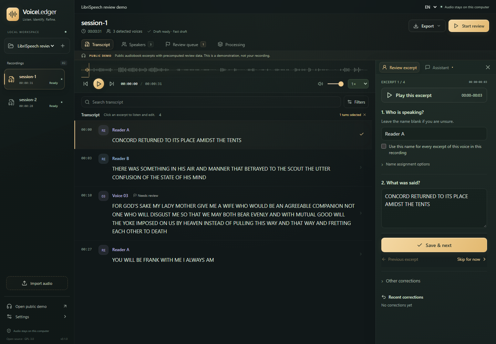
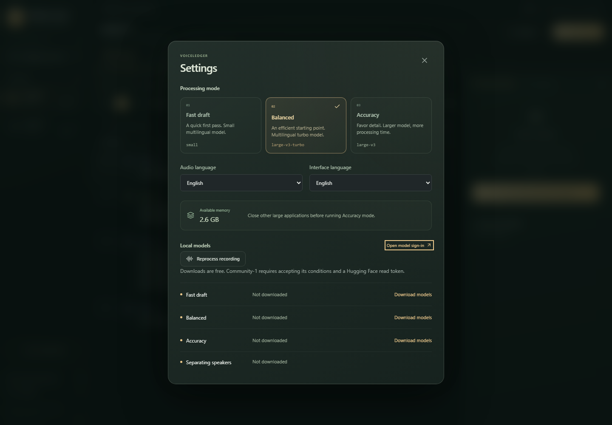

# Interface and motion

VoiceLedger uses a charcoal, sage and amber palette, with lightly translucent panels and clear primary actions. The transcript and ordinary name/text review remain the main workspace. Effects never add vertical space to the compact layout.

## Motion

`polish.css` owns visual effects and shared timing. Most feedback takes 160–380 ms with an ease-out curve. Click ripples last 560 ms and remove themselves on completion or cancellation. Tab highlights use one moving element; recording audio is not remounted when switching between Transcript and Review queue. Progress bars animate a scale transform instead of repeatedly changing layout width.

`Motion.tsx` supplies small shared behaviors using CSS and the browser's animation API, without adding a motion dependency. Dialogs retain their exit state for 180 ms, trap focus, make the background inert, close on Escape, and return focus to the opener. Popover filters close on outside interaction or Escape. New excerpts animate their editor content without animating the position of virtual transcript rows.

The operating system's reduced-motion preference disables decorative animation, transitions, ripples and editor arrivals, including when the preference changes while the app is open. Loading placeholders animate only while loading. The decorative waveform animates only on the empty welcome screen. Reading and processing screens have no continuously moving background effects.

## Processing feedback

Each recording shows its duration and whether a draft is ready. An unfinished active recording explains why its transcript has not appeared, displays progress and links to Processing. Processing lists jobs belonging to the selected project's recordings plus model-download jobs. It does not label other projects' recording jobs as models. Completed recording jobs link directly to their transcript.

## Verification

Browser checks use generated fixtures and the attributed public demo. They cover focus trapping and restoration, Escape/outside dismissal, animation cleanup, reduced motion, project job filtering, combined name/text saving, long virtualized transcripts, actual playback, and short/narrow layouts in both languages. Screenshots capture completed animation states. No browser test needs private recordings, model weights or account credentials.
